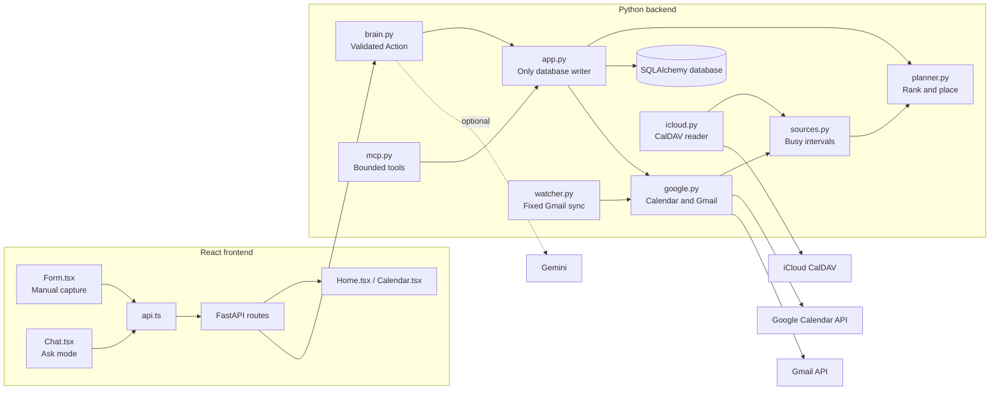

  

<h1 align="center">Cooper</h1>

A conversational planning workspace for tasks, events, and everyday commitments.

  
  
  
  
  
  

## Overview

Cooper is a personal planning workspace that turns plain-language input into organized tasks,
events, and time-aware plans. It gives each item a priority, explains the ranking, and schedules
estimated work around the commitments already on the calendar.

The product is designed for one person at a time. The hosted public beta supports private accounts
through verified email/password or Google sign-in, but it is not a team or project-management tool.

## Product capabilities

- Capture tasks and events through a structured form or conversational input.
- Rank work by deadline, importance, age, and estimated effort.
- Schedule estimated tasks inside configured working hours.
- Display the day, ranked work, fixed events, and scheduled blocks in one workspace.
- Undo the latest change, including a complete scheduling run.
- Connect Google Calendar and Gmail as read-only commitment sources. Cooper stores new calendar
  items locally.
- Read iCloud calendars through CalDAV so those commitments also block scheduling.
- Normalize local, Google, iCloud, and Gmail commitments into one deduplicated planning snapshot
  used by calendar cells, navigation counts, task state, workload facts, and common Ask questions.
- Confirm creation and scheduling only after the committed item is visible in refreshed planning
  state, preserving overlap and unavailable-calendar warnings.
- Google Calendar and iCloud Calendar acceptance flows were manually verified on 2026-09-14;
  the repeatable checklist and privacy-safe record live in `docs/LIVE_PROVIDER_ACCEPTANCE.md`.
- Answer common focus, remaining-work, next-action, deadline, workload, and fit questions directly
  from current COOPER state; use bounded read tools for longer-tail Ask questions.
- Continue capturing, ranking, and scheduling without a Gemini key or a connected Google account.
- Install the frontend as a responsive PWA with light and dark themes.

## Technology stack

| Area                         | Technology                                                             |
| ---------------------------- | ---------------------------------------------------------------------- |
| Backend                      | Python 3.12, FastAPI, Uvicorn                                          |
| Validation and configuration | Pydantic Settings                                                      |
| Persistence                  | SQLAlchemy, Alembic, SQLite, PostgreSQL                                |
| Frontend                     | React 19, TypeScript, Vite                                             |
| Authentication               | Firebase Authentication with Google or verified email/password sign-in |
| Calendar and mail            | Google Calendar/Gmail REST APIs and iCloud CalDAV                      |
| AI assistance                | Gemini, supplied per browser through Settings                          |
| Delivery                     | Firebase Hosting for the frontend and Render for the API               |

## Architecture

Cooper keeps the model, application state, and external services separate. The backend has one
database writer and one scheduling pipeline.

### Backend boundaries

- `brain.py` parses input and returns a validated `Action`. It never accesses the database.
- `app.py` validates and executes every mutation, including events parsed from email.
- `planner.py` ranks and places work without network or database I/O.
- `sources.py` combines Cooper blocks, Google Calendar events, iCloud events, and reconciled Gmail
  commitments into the busy intervals used by the planner.
- `google.py` handles Google Calendar/Gmail reads and per-owner OAuth tokens; new Cooper blocks
  are saved locally rather than written back to Google.
- `icloud.py` reads iCloud calendars with encrypted owner credentials and never writes remotely.
- `mcp.py` defines bounded tool schemas shared by Ask and the authenticated MCP endpoint.
- `watcher.py` runs the fixed-interval Gmail sync and reports its last check through the app.

### Frontend structure

The React frontend is organized around the four primary product areas:

- `Home.tsx` presents the next action, today's schedule, attention items, and ranked work.
- `Form.tsx` captures structured items without parsing or network access.
- `Chat.tsx` handles conversational input and text-only AI answers.
- `Calendar.tsx` renders day, week, and month views.
- `Nav.tsx` provides the responsive desktop rail and mobile navigation.
- `Mascot.tsx` renders the Cooper mascot states used across the product.
- `landing/` contains the public landing, authentication, Terms, and Privacy pages.

### Data model

Cooper uses three owner-scoped tables:

- `item` stores tasks and events. A fixed time distinguishes an event from a task.
- `setting` stores working hours, provider state, encrypted tokens, and watcher health.
- `change` stores the snapshots required to undo the latest mutation.

SQLite is the local default. Hosted deployments use PostgreSQL through the same SQLAlchemy model.
Supabase Postgres is the recommended beta database; Cloud SQL remains the single-provider alternative.
Use a server-only Supabase pooler connection for runtime traffic. Firebase remains
responsible for identity, and Supabase Auth and Supabase Storage are not used.

### Security and privacy

- Firebase ID tokens identify hosted users, and every query is scoped by the verified owner.
- Google refresh tokens are encrypted before storage.
- iCloud app-specific passwords are encrypted server-side and never returned to the browser or model.
- Manual mode never calls a model or the network.
- A Gemini key entered in Settings stays in that browser and is sent only with AI requests.
- Titles are sanitized before they reach a model.
- Remote failures do not block local capture or scheduling. Local data remains the source of truth.

## Design principles

Cooper follows a small set of product rules:

1. The model proposes an action. Application code decides whether it is valid and executes it.
2. The planner places work only within configured working hours.
3. Ambiguous references produce a question instead of a guess.
4. Green indicates a completed or added item. Red indicates a deleted item.
5. Calendar integrations are additive. Cooper remains useful without them.

## Project documentation

- [`PRD.md`](PRD.md) defines the product requirements and non-goals.
- [`ARCHITECTURE.md`](ARCHITECTURE.md) documents the current implementation in detail.
- [`AGENTS.md`](AGENTS.md) records the contribution and engineering constraints.
- [`docs/WORKFLOW.md`](docs/WORKFLOW.md) defines the lightweight ticket, branch, PR, release, and
  incident workflow for solo development.
- [`docs/RECOVERY.md`](docs/RECOVERY.md) documents backup, restore, and deployment recovery steps.
- [`docs/DESIGN.md`](docs/DESIGN.md) describes the visual system and interaction rules.
- [`docs/LIVE_PROVIDER_ACCEPTANCE.md`](docs/LIVE_PROVIDER_ACCEPTANCE.md) provides the local
  Google, Gmail, iCloud, and Cooper-local scheduling acceptance checklist, including the latest
  manual verification record.

## License

This repository is not currently distributed under an open-source license. All rights reserved.

## Author

Created and maintained by **Alex L. Berin**.
